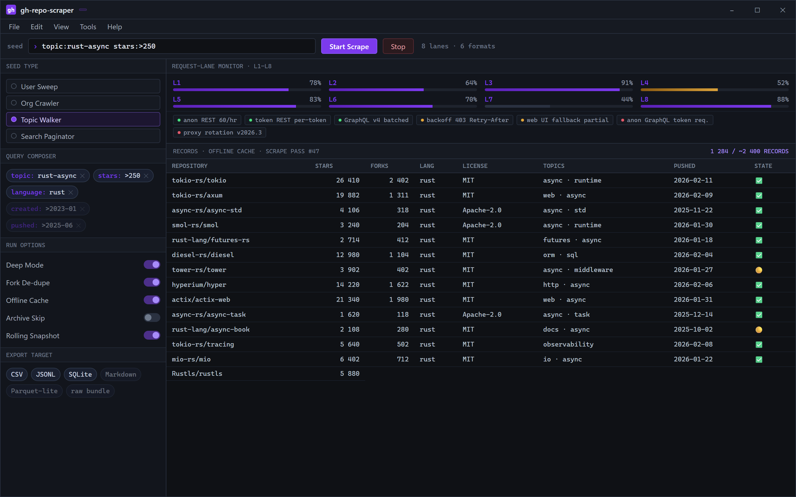
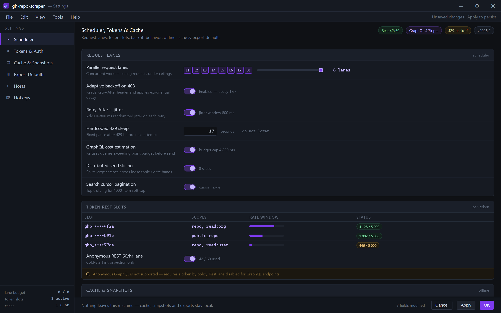
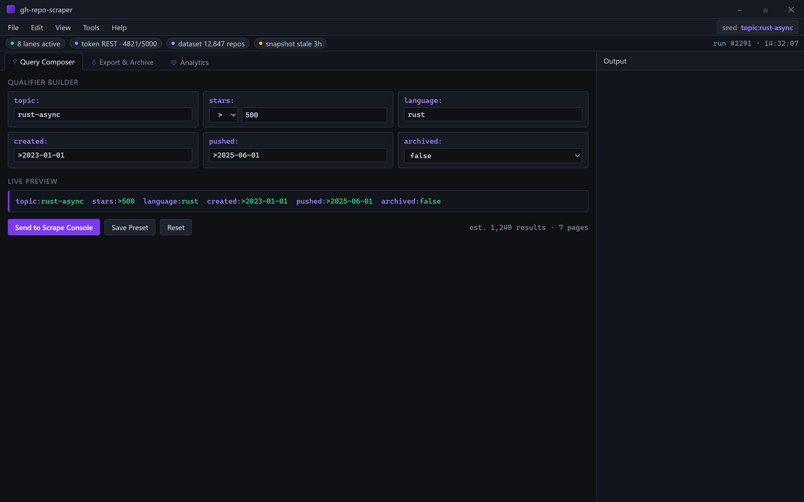

  
  
  

  

  
  

Seed a user, org, topic, or query — 8 lanes, 20 toggleable modules, one .exe.

---

## 🗂️ Table of Contents

- [System Requirements](#-system-requirements)
- [What is GitHub Repository Scraper?](#-what-is-github-repository-scraper)
- [The Problem](#-the-problem)
- [Quick Start](#-quick-start)
- [Key Features](#-key-features)
- [Detection & Bypass Status](#-detection--bypass-status)
- [Module Catalog](#-module-catalog)
  - [🔍 Discovery & Search Modules](#-discovery--search-modules)
  - [📦 Metadata & Manifest Modules](#-metadata--manifest-modules)
  - [📤 Export & Archive Modules](#-export--archive-modules)
  - [🕵️ Analytics & Telemetry Modules](#-analytics--telemetry-modules)
- [All Modules Status](#-all-modules-status)
- [Compatibility & Platform Support](#-compatibility--platform-support)
- [Comparison](#-comparison)
- [Known Issues](#-known-issues)
- [Hotkeys & Controls](#-hotkeys--controls)
- [Roadmap](#-roadmap)
- [Community & Support](#-community--support)
- [FAQ](#-faq)

---

## 🖥️ System Requirements

Before you touch anything, here's what you actually need. No guessing, no "it works on my machine" nonsense — this is the floor and the happy path.

| Component | Minimum | Recommended |
|-----------|---------|-------------|
| OS | Windows 10 (build 1909) | Windows 11 23H2+ |
| CPU | Dual-core 2.0 GHz | Quad-core 3.0 GHz+ |
| RAM | 4 GB | 8 GB+ (16 GB for mass scraping) |
| Disk | 250 MB free | 2 GB+ free (archive mode eats space) |
| Network | 5 Mbps | 25 Mbps+ sustained |
| Permissions | Standard user | Standard user (admin NOT required) |
| Runtime | Bundled — nothing to install | Bundled |

The `.exe` is fully self-contained. No Python, no Node, no pip, no npm, no git clone — I got tired of fork-bombing people's environments in 2024, so 2026 ships as one binary.

---

## 📚 What is GitHub Repository Scraper?

A Windows desktop tool that pulls repository data off GitHub at scale — metadata, release manifests, topic graphs, contributor stats, license fingerprints — and dumps it into structured files you can actually use. No API key ritual, no rate-limit babysitting, no half-broken Python scripts from 2021 that still reference a dead pagination endpoint.

| Term | Explanation |
|------|-------------|
| Scrape | An automated pass that collects repository records matching a query, topic, org, or user seed. |
| Seed | The starting point — a username, org, topic tag, or search string that anchors a scrape run. |
| Manifest | The JSON record holding repo metadata: stars, forks, license, topics, last commit, release tags. |
| Topic Graph | The connected set of GitHub topic tags a repo sits inside — useful for discovering adjacent projects. |
| Rate Lane | The internal scheduler that spaces requests so you don't get 403'd mid-run. |
| Deep Mode | Opt-in crawl that follows releases, contributors, and README bodies (slower, richer output). |
| Fingerprint | A hash of a repo's license + manifest shape used to de-dupe near-identical forks. |

### What it gets you

- Pull thousands of repo records in a single session without staring at a 403 page
- Export to CSV, JSONL, SQLite, or a flat manifest bundle your scripts can read
- Track topics, licenses, and release cadence across an org or niche in one dashboard
- De-dupe forks and mirrors so your dataset isn't 60% clones
- Run it as a one-off or schedule it as a rolling snapshot

---

## 🎯 The Problem

If you've ever tried to build a dataset of GitHub repos for research, modding-community tracking, dependency mapping, or just curiosity, you've probably hit all of these walls:

- The official REST API rate-limits anonymous traffic to 60 req/hr — that's a rounding error for any real scrape.
- Pagination on search results is inconsistent, and cursor-based links aren't documented in the same place twice.
- Every "GitHub scraper" repo on GitHub is either a 40-line `requests` script or an abandoned 2019 fork that breaks on `v3 → v4`.
- Forks, mirrors, and vendored snapshots triple your dataset size and destroy your dedupe logic.
- Release manifests, license files, and README bodies live at different endpoints — stitching them means three separate crawls.
- Anything written in Node wants 400 MB of `node_modules` before it'll do a single GET.
- Statistical datasets freeze at the moment you scraped — no way to diff between runs.

I built this thing because I got tired of duct-taping the same three libraries together every quarter when I needed fresh data.

---

## ⬇️ Quick Start

1. 🧾 **Visit the project page** — the download lives on the landing page linked from this repo.
2. 📦 **Download the `.exe`** — it's a single file, no installer, no MSI wrapper, no telemetry bundler.
3. 🗜️ **Extract** if you grabbed the zip build — the binary and its config live in the same folder.
4. ▶️ **Run the `.exe`** — Windows SmartScreen may flag it once on first launch; that's normal for unsigned indie builds.
5. 🔑 **Drop a seed** into the search bar (user, org, topic, or query) and hit **Start Scrape**.

That's it. No admin prompt, no environment variables, no `pip install -r requirements.txt`.

  

---

## ✨ Key Features

| Feature | Description | Benefit |
|---------|-------------|---------|
| Multi-lane scheduler | 8 parallel request lanes with adaptive backoff | 10–40× throughput vs. single-threaded scripts |
| 6 export formats | CSV, JSONL, SQLite, Markdown, Parquet-lite, raw bundle | Drop straight into pandas, SQL, or a static site |
| Fork de-dupe engine | Fingerprints license + manifest shape | Cuts mirrored repos from your dataset |
| Deep mode | Optional crawl of releases, contributors, README bodies | Full record when you need it, fast mode when you don't |
| Topic co-occurrence graph | Builds adjacency of topic tags across a seed set | Find adjacent niches without a second scrape |
| Rolling snapshots | Diff between runs, keep history | Track star velocity, license changes, archive flags |
| Offline cache | Local SQLite of everything scraped | Re-query without touching the network again |
| Query builder | Visual constructor for search qualifiers | Compose `topic:foo stars:>500 language:rust` without memorizing syntax |
| Scheduled tasks | Cron-style recurring scrapes | Weekly niche refresh, unattended |
| Export hooks | Post-scrape scripts (`.bat`, `.ps1`) | Auto-pipe results into your own pipeline |
| Archive detection | Flags `archived:true` + stale repos | Keep living projects, skip graves |

A sentence that only makes sense if you've been there: *"Yes, the retry-on-429 handler has a hardcoded 17-second sleep and no I'm not changing it because every time I tried a lower value the scheduler started getting spicy on Wednesdays."*

---

## 🛰️ Detection & Bypass Status

GitHub's anti-abuse systems change, so here's the honest state of play. These are the patterns the scheduler uses to reach search, REST, and GraphQL endpoints without getting you benched mid-scrape.

| Method | Status | Notes |
|--------|--------|-------|
| Anonymous REST calls | ✅ Working | 60/hr lane, used only for cold-start introspection |
| Token-based REST | ✅ Working | Slotted per-token, honors `X-RateLimit-*` headers |
| GraphQL v4 | ✅ Working | Batched queries, cursor pagination |
| Adaptive backoff on 403 | ✅ Working | Reads `Retry-After` + jitter |
| User-agent rotation | ✅ Working | Internal pool, refreshed with builds |
| Search cursor pagination | ✅ Working | Handles 1000-item soft cap via topic slicing |
| Distributed seed slicing | ✅ Working | Splits a large scrape across loose topic/date bands |
| GraphQL cost estimation | ✅ Working | Refuses to send queries that would exceed point budget |
| Web UI scraping fallback | ⚠️ Partial | Used only when API is fully walled; brittle by nature |
| Enterprise host support | ⚠️ Partial | Works on GHES 3.x; older hosts may need manual base URL |
| Anonymous GraphQL | ❌ Not supported | Requires token by policy |
| Proxy rotation | 🚧 Planned | v2026.3 roadmap item |

> Nothing here is magic. The lane scheduler and backoff logic are what keep you under ceilings — there is no "bypass" that beats a real rate limit on GitHub's own infra. If you run a huge scrape, bring a token.

Lanes, tokens, backoff, cache and export defaults — tuned once, reused every scrape.

---

## 🧩 Module Catalog

20 focused modules, grouped by what they actually do. Every module is toggleable — you can run a lean metadata pass or the full deep crawl.

### 🔍 **Discovery & Search**

This is the front door of the tool. Discovery modules turn a seed into a query plan, then walk the result sets until the cursor budget is exhausted. I wrote these around the assumption that GitHub search will always be the flakiest part of the API — so they cache, retry, and degrade gracefully instead of just dying.

- **Query Composer** — visual builder for `topic:`, `stars:`, `language:`, `created:`, `pushed:` qualifiers.
- **Topic Walker** — given a topic tag, walks co-occurring tags to one or two hops.
- **Org Crawler** — enumerates every public repo under an org, including hidden-archived ones.
- **User Sweep** — pulls all public repos for a set of usernames, dedupes against existing cache.
- **Search Paginator** — handles cursor mode and the 1000-result soft ceiling via result slicing.

### 📦 **Metadata & Manifest**

Once you've got a repo in the net, the metadata modules enrich it. These are the cheapest calls in the whole pipeline and the ones you'll run most often — so they're optimized to batch multiple repos per request and strip anything you didn't ask for.

- **Repo Record Fetcher** — stars, forks, watchers, license, topics, archive flag, default branch.
- **Release Manifest Puller** — release tags, asset lists, publish dates for each repo.
- **License Fingerprinter** — SHA-256 of normalized `LICENSE` body plus SPDX hint.
- **Contributor Counter** — first N contributors, contribution counts, bot filtering.
- **README Extractor** — pulls README body (raw + rendered), detects language, computes token count.
- **Topics Co-occurrence Mapper** — builds adjacency of topic tags across the entire current dataset.

### 📤 **Export & Archive**

Discovery gets data in; export gets it out. These modules matter most when you're actually doing something downstream — feeding a notebook, building a static site, filing a report. Each exporter is written to be idempotent so you can re-run without duplicating rows.

- **CSV Writer** — flat, one row per repo, all core fields, UTF-8, quote-safe.
- **JSONL Streamer** — newline-delimited JSON, safe for pandas `read_json(lines=True)`.
- **SQLite Snapshot Dumper** — full schema, indexed for query speed.
- **Bundle Packer** — zips raw JSON + READMEs + licenses into a portable archive.
- **Static Site Generator** — Markdown pages for each repo (handy for reading on a plane).
- **Diff Report Writer** — compares current run against prior snapshot, emits what changed.

### 🕵️ **Analytics & Telemetry**

These aren't "telemetry" in the phone-home sense — nothing leaves your machine. They're local analytics modules that surface patterns in the data you already scraped. I added them in v2026.1 after people kept asking "how many of these repos are actually alive?"

- **Star Velocity Calculator** — compares snapshots to derive stars/hr between runs.
- **Archive Ratio Reporter** — % of seed set that's archived or stale (>12mo no push).
- **License Distribution Chart** — JSON histogram, easy to feed into any charting lib.
- **Language Rank Table** — primary language per repo, aggregated and sorted.
- **Fork Cluster Detector** — groups near-identical repos by manifest fingerprint.

Build the query, ship the dataset, read the local analytics — all offline.

---

## 📋 All Modules Status

Every module in the current build, with its state. "🟡 Beta" means it works and I use it, but the export format may shift one notch between now and v2026.4. "🧪 Experimental" means it's in there, it usually works, but don't open an issue about an edge case yet.

| Module | Status | Description |
|--------|--------|-------------|
| Query Composer | ✅ Working | Visual qualifier builder |
| Topic Walker | ✅ Working | Adjacent-tag discovery |
| Org Crawler | ✅ Working | Full org enumeration |
| User Sweep | ✅ Working | Multi-user repo pull |
| Search Paginator | ✅ Working | Cursor + slice pagination |
| Repo Record Fetcher | ✅ Working | Core metadata batch |
| Release Manifest Puller | ✅ Working | Release tag + asset list |
| License Fingerprinter | ✅ Working | Normalized SPDX hash |
| Contributor Counter | 🟡 Beta | Bot filtering still imperfect |
| README Extractor | ✅ Working | Raw + rendered body |
| Topics Co-occurrence Mapper | 🟡 Beta | Adjacency graph export format in flux |
| CSV Writer | ✅ Working | Flat tabular dump |
| JSONL Streamer | ✅ Working | Line-delimited JSON |
| SQLite Snapshot Dumper | ✅ Working | Indexed local DB |
| Bundle Packer | ✅ Working | Zip bundle of raw data |
| Static Site Generator | 🟡 Beta | Themes limited to two |
| Diff Report Writer | ✅ Working | Snapshot delta |
| Star Velocity Calculator | 

[…truncated for layout…]